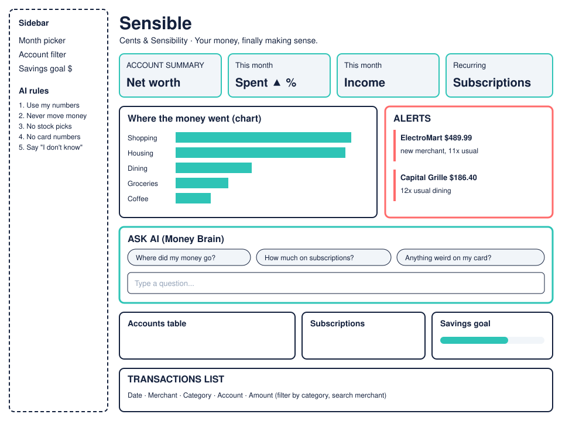

# Team Sheet: Cents & Sensibility

**App:** Sensible · *"Your money, finally making sense."*
**Repo:** `cents-and-sensibility-dashboard`
**Brand colors:** Ink `#14213D` · Mint `#2EC4B6` · Coral `#FF6B6B` (alerts only)

## Roles (Task 2)

| Role | Name | Event 1 job | Status |
|---|---|---|---|
| Developer | ____________ | Set up repo, run the app, put team name in `app.py` | App runs, team name in title |
| Designer | ____________ | Sketch the main screen | [sketch.svg](sketch.svg) |
| AI Prompter | ____________ | 5 money questions + assistant rules | Below + [assistant-rules.md](assistant-rules.md) |
| Researcher | ____________ | Competitor check, feature list, what could go wrong | Below + [security-risks.md](security-risks.md) |

Team of 3? Designer + Researcher is the easiest pair to combine.

## Features (Task 3)

**Must-haves**
1. A user can see all their accounts, balances, and net worth in one place.
2. A user can see where their money went this month, by category, and how that compares with last month.
3. A user can get an alert when a charge looks unusual (much bigger than normal, or a new merchant charging a lot).

**Nice-to-haves**
4. A user can see every subscription they pay for and when the next charge lands.
5. A user can set a savings goal and watch progress toward it.

All 5 are built and running in the app. The Ask box (the AI) is the Event 3 upgrade.

## 5 questions a real person would ask (AI Prompter)

1. Where did my money go this month?
2. How much am I paying for subscriptions?
3. Did anything weird hit my card recently?
4. Am I spending more than last month?
5. How much did I spend on dining out?

These are the one-click buttons in the app's Ask box, and each has a test in `tests/test_assistant.py`.

## Competitor check (Researcher, Silver bonus)

| App | Does well | Gap Sensible can fill |
|---|---|---|
| **Rocket Money** | Finds your subscriptions and helps cancel them | The best parts sit behind a paid tier, and it shows lists and charts, not plain-language answers to "why did I spend more?" |
| **YNAB (You Need A Budget)** | Strict zero-based budgeting ("give every dollar a job") that changes habits | Steep learning curve and a paid subscription. A student who just wants a quick answer about their money has to learn a whole system first |

Context: Intuit shut down Mint in 2024, so a lot of students lost their free all-in-one money app. Sensible goes after that gap: free, all accounts in one place, and you can ask it questions in plain English.

## Sketch (Task 4)

